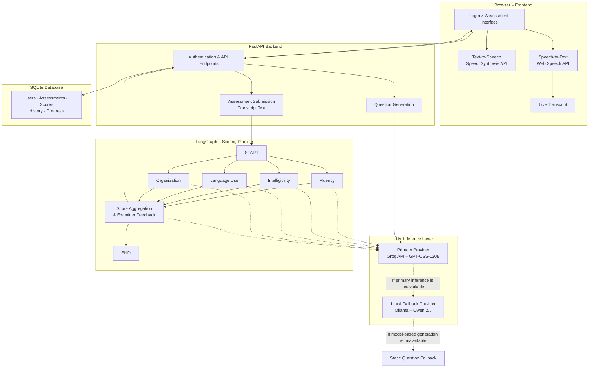

# Eloquence – AI-Powered Speaking Assessment Platform

Eloquence is a voice-based speaking assessment and improvement platform inspired by the TOEFL independent-speaking format. Users can log in, complete four spoken questions (for custom time), and receive dimension-wise scores, examiner-style feedback, and an application-defined TOEFL-style performance band.

Built using **Python, FastAPI, LangGraph, Groq GPT-OSS-120B, SQLite, and Ollama**, Eloquence combines browser-based voice interaction with parallel LLM-based evaluation and progress tracking across practice assessments.

## How It Works

Eloquence follows a browser-to-backend architecture. The browser handles voice interaction, FastAPI manages authentication and API requests, and LangGraph orchestrates the speaking assessment workflow.

### System Architecture



*The diagram illustrates the intended primary/fallback inference arrangement. The actual provider selected at runtime depends on the application configuration.*

### 1. Voice Interaction – Browser

- **Speech-to-Text (STT):** Uses the browser's Web Speech API (`webkitSpeechRecognition`) to convert spoken responses into text.
- Recognition runs with `continuous` and `interimResults` enabled, allowing the application to display a live transcript while the user speaks.
- Finalized recognition chunks are appended to the final transcript, while interim results are displayed as provisional text.
- **Text-to-Speech (TTS):** Uses the browser's `speechSynthesis` API and `SpeechSynthesisUtterance` to read topics and questions aloud.
- The question-reading sequence triggers the preparation countdown when speech synthesis finishes.

**Browser compatibility:** Chrome or Edge is recommended.

**Audio handling:** The application backend receives and evaluates transcript text, not raw audio recordings. Browser speech recognition may use browser-vendor or operating-system speech services, depending on the implementation. Therefore, this does not guarantee that audio processing stays entirely on-device.

### 2. Question Generation

Eloquence generates a fresh set of speaking questions for each assessment using its configured LLM inference provider.

- Groq with GPT-OSS-120B is the primary cloud inference option when configured.
- Local Ollama with Qwen 2.5 provides a fallback inference option.
- A static question fallback is available if model-based question generation is unavailable.
- Generated questions are presented through the browser's text-to-speech interface.

### 3. Parallel Evaluation – LangGraph

LangGraph orchestrates four specialized scoring nodes. Each node evaluates the submitted transcript against a separate speaking dimension.

| Scoring node | Evaluation focus |
|---|---|
| **Fluency** | Response flow, continuity, hesitation, and unnecessary repetition |
| **Intelligibility** | Clarity of expression and transcript-based indicators of comprehensibility |
| **Language Use** | Grammar, vocabulary, and language accuracy |
| **Organization** | Coherence, logical sequencing, and development of ideas |

**Workflow:**

`START → Four parallel scoring nodes → Aggregation → END`

- Each scoring node makes a specialized LLM call.
- Each dimension receives a score on a 0–5 scale along with reasoning.
- The four evaluations execute in parallel rather than sequentially.
- The aggregation stage combines the dimension scores, calculates the mean, maps it to the application's 1–6 performance band, and generates examiner-style feedback.

The scoring workflow uses five model calls: four dimension-specific evaluations and one examiner-summary generation call.

### 4. LLM Inference – Groq and Ollama

Eloquence supports cloud and local inference.

**Groq – Primary Cloud Inference**

- Uses the Groq inference API with `openai/gpt-oss-120b` as the default model.
- Provides cloud-based inference without requiring the user to run the large model locally.
- Automatically selected when `GROQ_API_KEY` is configured, unless overridden by `ELOQUENCE_PROVIDER`.

**Ollama – Local Fallback Inference**

- Supports local inference using Qwen 2.5.
- Provides an alternative when local inference is selected or the application uses its configured fallback behavior.
- Model inference happens locally rather than through Groq.
- The first response may take longer because the local model may need to load.

Groq provides the inference infrastructure; GPT-OSS-120B is the model developed by OpenAI.

### 5. Score Aggregation and Progress Tracking

After the parallel evaluations complete:

1. Individual dimension scores are collected.
2. The mean score is calculated.
3. The mean is mapped to an application-defined 1–6 TOEFL-style performance band.
4. Examiner-style reasoning and feedback are generated.
5. Assessment results are stored in SQLite.

The application supports per-user authentication and maintains assessment history, individual scores, dimension-wise averages, and progress trends across practice sessions.

## Important Evaluation Limitation

Eloquence evaluates the **speech-to-text transcript, not the original audio**.

Consequently, it cannot directly measure acoustic pronunciation, accent, intonation, stress, or prosody. The intelligibility dimension is approximated using textual indicators such as fillers, fragmented expressions, incomplete sentences, and repeated language.

The TOEFL speaking criteria serve as a reference framework. The application's 1–6 band is an internally defined mapping and is not an official ETS score or a validated TOEFL prediction.

Eloquence is an independent practice tool and is not affiliated with or endorsed by ETS.

## Technology Stack

| Component | Technology |
|---|---|
| Frontend | HTML, CSS, JavaScript |
| Speech-to-Text | Browser Web Speech API |
| Text-to-Speech | Browser SpeechSynthesis API |
| Backend | Python, FastAPI |
| Workflow orchestration | LangGraph |
| Primary cloud inference | Groq API – GPT-OSS-120B |
| Local fallback inference | Ollama – Qwen 2.5 |
| Database | SQLite |
| Authentication | Salted PBKDF2 password hashing, bearer tokens |

## Setup and Installation

### Prerequisites

- Python installed
- Chrome or Edge browser
- Groq API key for primary cloud inference
- Ollama installed if local fallback inference is required

### 1. Configure Local Ollama (Fallback)

Install Ollama from [ollama.com](https://ollama.com/).

Pull the required model:

```bash
ollama pull qwen2.5
```

Start the Ollama server if it is not already running:

```bash
ollama serve
```

### 2. Create a Python Environment

From the project root:

```powershell
python -m venv .venv
.venv\Scripts\Activate.ps1

pip install -r requirements.txt
```

### 3. Configure Groq

Create an API key at [Groq Console](https://console.groq.com/).

Configure the key in PowerShell:

```powershell
$env:GROQ_API_KEY="gsk_your_key_here"
```

### 4. Start the Application

```powershell
cd backend
uvicorn main:app --port 8010
```

Open the application in Chrome or Edge:

**http://localhost:8010**

Register an account and begin your speaking assessment.

## Model Configuration

### Option 1: Groq Cloud Inference (Primary)

Groq provides cloud inference using GPT-OSS-120B.

Configure:

```powershell
$env:GROQ_API_KEY="gsk_your_key_here"
```

The application automatically selects Groq when the API key is available, unless overridden by `ELOQUENCE_PROVIDER`.

### Option 2: Local Ollama Inference

To use a smaller local model:

```bash
ollama pull qwen2.5:3b
```

Configure the application:

```powershell
$env:ELOQUENCE_PROVIDER="ollama"
$env:ELOQUENCE_MODEL="qwen2.5:3b"
```

Then start the application:

```powershell
uvicorn main:app --port 8010
```

**Privacy consideration:** With Groq cloud inference, transcript text is sent to Groq for processing. With local Ollama inference, model inference happens locally. Browser speech recognition may still involve external browser-vendor services.

## Environment Variables

| Variable | Purpose |
|---|---|
| `ELOQUENCE_PROVIDER` | Selects the inference provider |
| `GROQ_API_KEY` | Groq API authentication |
| `GROQ_MODEL` | Groq model selection; default `openai/gpt-oss-120b` |
| `ELOQUENCE_MODEL` | Ollama model selection; default `qwen2.5:latest` |
| `OLLAMA_HOST` | Ollama server endpoint; default `http://localhost:11434` |
| `ELOQUENCE_DB` | SQLite database location |

## Security

- User passwords are stored as salted PBKDF2 hashes.
- Authentication uses bearer tokens.
- Session tokens are stored in browser `localStorage`.
- API keys should be configured through environment variables and must never be committed to GitHub.
- `.env` files and local database files should be excluded from version control.

## Project Goal

Eloquence aims to make structured speaking practice more accessible by combining browser-based voice interaction, parallel LLM-based assessment, examiner-style feedback, and persistent progress tracking in one application.
